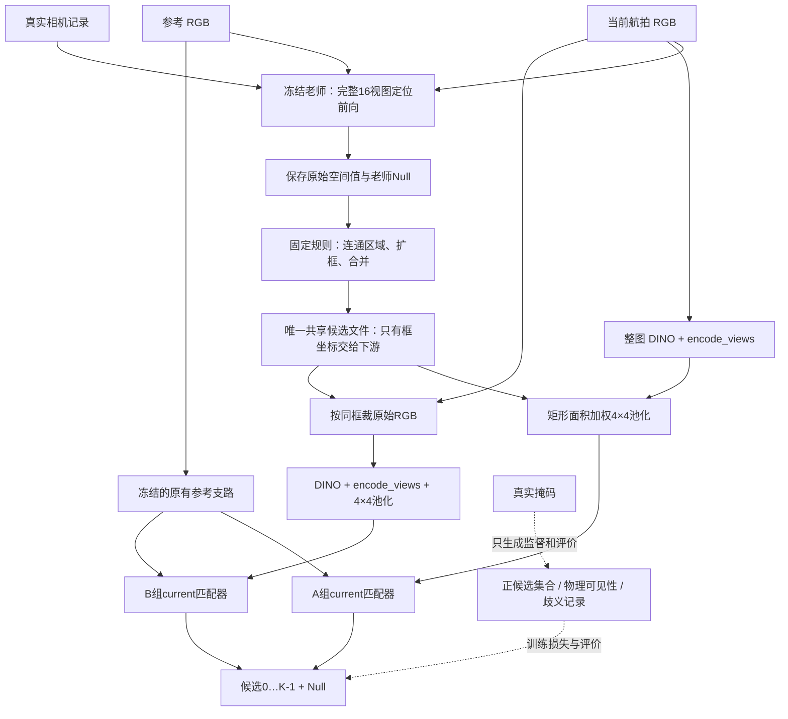

# 老师区域 A/B 单帧对照：实现与服务器运行

本轮只检查输入策略：同一个老师框，整图编码后取特征（A），还是先裁原始 RGB 再编码（B）。编码器、参考支路和老师定位权重冻结，只训练 current 单帧匹配器。不改变时序融合、跨帧关联或飞行策略。

2026-11-11 本机状态：实现已写入；本机只做文件、来源、语法和纯几何/标签检查。没有运行网络前向、训练、特征提取或模型评估，没有 SSH。下面的服务器产物需要实际执行命令后生成，不是已取得的实验结果。

## 已核对的输入

|输入|核查结果|
|---|---|
|数据|`data/search_grid_smoke_v1`，200 张 RGB，400 个图片参考对|
|划分|121 张训练 RGB、79 张 probe RGB；对应242/158对；RGB无交叉，老师拟合图强制归入训练|
|来源校验|464 个源文件哈希通过，包括图像、参考、掩码、元数据|
|老师|`out/teacher_grid_fit_e20_retry/last.pt`，epoch20，当前本地复现版，曾在4张RGB上拟合；不是老师原始成熟权重|
|老师 SHA256|`a8eb9e1e41ce380a12a26f76d602a7dc9fd9b33ad35f026cd00f5ccef559ed35`|
|骨干 SHA256|`0b8b82f85de91b424aded121c7e1dcc2b7bc6d0adeea651bf73a13307fad8c73`|
|编码规格|ViT-B/14、518×518、层3/6/9/12、768→256；老师完整16 views，原图网格32×32|
|旧缓存|`memory_fullview_cache_server_v1` 本机不存在；旧 GT 掩码池化缓存不能复用为本轮矩形区域特征|
|旧实验|memory_e200 本机目录存在；数字不进入本轮 A/B 直接比较表|

服务器目录和 conda 环境沿用交接约定，尚未远程核实。服务器命令会现场检查 CUDA、输入文件、源码和真实权重；缺失就停止，不下载替代权重、不退回 CPU。

## 数据流



每个候选的输入是 `16×256` 和16个有效标记，参考输入是 `64×256` 和64个有效标记。网络只接收这四项；老师分数、老师排名、候选编号、车辆真实身份、原图框坐标不作为额外网络输入。老师框本身依赖参考，因此用场景、帧、参考共同索引；评价再按 RGB 哈希＋参考哈希去重。

每帧 `EvidenceMatcher(mode='current')` 从初始槽重新开始：writer 整理每个候选，reader 根据参考读取，match 打分，再与可训练 Null 标量共同归一化。没有历史状态传入。

## 固定规则

**老师区域。** 对真实前向的原始空间输出除以总和，仅去除其整体质量尺度。阈值为 `max(条件空间峰值×0.45, 2/1024)`；8邻域连通格先合成一个区域；宽高扩大1.5倍、最短边96原图像素，裁到图像边界；IoU≥0.3 或交集/较小框≥0.6 的框合并。最多保留8框；限额使用老师峰值，最终按坐标排列。保存所有连通格、合并来源及因限额丢弃的框。全平或全零输出允许没有候选。无 GT 修框、补框、拆多车框或按 GT 选排名。

**A。** 原图做原有等比缩放补边、ImageNet归一化、DINO，然后单个 full view 的 `encode_views`。矩形划成4×4，每格按与DINO patch相交面积加权池化。使用实际圆整后的缩放宽高和补边偏移，不假定两个方向缩放恰好相等。整框背景参与编码与池化。

**B。** 从原始分辨率RGB裁完全相同的整数半开区间框，裁图单独执行上述冻结编码，几何按裁图自身计算；对整个裁图4×4池化。补边面积权重为0；部分含补边的patch仍可能有补边感受野，这是原编码方式的限制。B同时改变目标尺度、上下文、位置分布，不能把改善单独归因于背景或分辨率。

**监督。** 标注文件与特征文件分开。可确认单车框需满足：覆盖该车可见像素≥50%，框内该车≥32像素，占框面积≥2%，按原整图缩放到518后的该车面积≥196像素。第二辆车若有≥16像素，且覆盖该车≥10%或占框≥2%，视为明显第二车；两辆明显车辆同框标歧义。ignore区域≥16像素且占框≥2%也标歧义。不能确认的碎片、背景、歧义框不分配确定车辆身份，不拆框。另记超大框（图像面积≥50%）、各车覆盖率及占比。

参考目标可对应多个合格框，正集合记为 S；训练损失为 `logsumexp(所有候选和Null) − logsumexp(S)`。没有合格框时 S 只有 Null。相邻框重复覆盖同一目标可同时为正。

**Null。** 指候选集合中无可确认目标区域。目标仍物理可见但老师漏框时，下游 Null 可以正确拒绝候选，却仍然是整链失败。含歧义车辆的框不能算正确找到。物理可见性来自原始掩码，绝不由特征有效性决定。

**失败。** 单候选无效或某组特征提取失败会保存错误和空特征，不修改原标签。训练阶段，这个图片参考对同时从 A/B 的损失中排除，记录排除清单；评价保留原分母，并保守地把任意提取失败记为链路失败。整批没有可用训练样本则两组都跳过该批更新。空候选本身不是失败。来源损坏、缺权重或 OOM 停止整轮并保留不完整目录，不擅自缩小输入或替换骨干。

## 训练预算与评价

- seeds 7、17、27；每组100轮；AdamW lr=1e-4，weight_decay=0.01；batch8；current的heads4、slots8。
- 每轮去重后的242个训练对各出现一次，不用24×8路线；正常情况下每轮31次更新，每组每种子3100次更新，共6次训练。排除的失败对和实际更新数另记。
- 每个种子 A/B 初始化哈希必须相同；每轮随机样本顺序、候选排列和更新次数也必须相同。候选打乱后同步重映射正集合。
- 先做服务器合成前向/反向检查与两次真实训练批次检查，丢弃这些临时权重，再开始固定种子。
- 仅固定最终100轮评价，训练中不看 probe 来挑参数或轮次。如果数据另有明确val/test布局，分别报告，拒绝将两者合并。
- 三层评价：老师像素覆盖与可确认召回；同一可确认覆盖样本上的匹配/错误Null/去Null排序；包括漏检、歧义、失败的端到端结果。仅一个候选的排序容易虚高，另报有负候选的排序。
- 每个种子分别保存所有预测、logit、概率、选择、错误标记和计数；汇总均值、总体标准差、范围及配对B−A差值。
- 保存最终权重后，重新加载并重放全部留出对；要求选择一致、logit最大绝对误差≤2e-5。

这是单布局诊断，不能冒充独立场景测试。只评单帧输入，不能直接证明记忆融合有效。

## 服务器完整命令

先同步代码，再在服务器终端执行（不是本机 PowerShell）：

```bash
cd /mnt/fast18/sunbo/DINO
conda activate dino-probe
git pull --ff-only origin codex/evidence-memory-v1
set -euo pipefail

# 不创建网络、只核实 CUDA 与真实资产；找不到时会打印实际搜索目录。
python - <<'PY'
from pathlib import Path
import sys
import torch
from dinoexp.local_paths import resolve_backbone_paths
from dinoexp.region_ab_data import sha
assert torch.cuda.is_available(), '需要CUDA服务器，不能改CPU运行'
assert Path('data/search_grid_smoke_v1/dataset_manifest.json').is_file()
assert Path('out/teacher_grid_fit_e20_retry/last.pt').is_file()
repo, weight = resolve_backbone_paths(None, None, 'dinov2_vitb14', Path.cwd())
assert sha(weight) == '0b8b82f85de91b424aded121c7e1dcc2b7bc6d0adeea651bf73a13307fad8c73'
assert sha('out/teacher_grid_fit_e20_retry/last.pt') == 'a8eb9e1e41ce380a12a26f76d602a7dc9fd9b33ad35f026cd00f5ccef559ed35'
print('Python:', sys.executable)
print('Torch/CUDA:', torch.__version__, torch.version.cuda)
print('GPU:', torch.cuda.get_device_name(0))
print('DINO repo:', repo)
print('DINO backbone:', weight)
PY

export CUBLAS_WORKSPACE_CONFIG=:4096:8
python -m unittest discover -s tests -p test_region_geometry.py
python -m unittest discover -s tests -p test_region_metrics.py
python -m unittest discover -s tests -p test_region_data.py
python -m unittest discover -s tests -p test_region_server.py

mkdir -p out
REGION_AB_OUTPUT="out/region_ab_$(date +%Y%m%d_%H%M%S)"
python -u run_region_encoding_ab.py run \
  --data data/search_grid_smoke_v1 \
  --teacher out/teacher_grid_fit_e20_retry/last.pt \
  --output "$REGION_AB_OUTPUT" \
  --device cuda --threads 4 --view-batch 1 --profile-pairs 10 \
  2>&1 | tee "${REGION_AB_OUTPUT}.run.log"
printf '结果目录：%s\n' "$REGION_AB_OUTPUT"
```

默认参数就是上面的三种子/100轮预算，准备前会写入 `prepared.json`。不会训练 mean/memory。

源码/权重若存于非标准位置，先将已有文件的真实绝对路径设置到 `DINO_REPO`、`DINO_BACKBONE`，再重跑预检查；也可以向运行入口传 `--model-repo`、`--backbone`。这两个路径不能从当前本机猜为服务器路径。已匹配的旧 `dense_reference_features` 缓存可选传 `--dense-cache`；不要传 `memory_fullview_cache_server_v1`。

`run` 顺序执行 prepare→train→profile→report。已有输出目录会拒绝覆盖。若准备已成功、训练尚未开始，可用同一个输出目录单独运行 `train`，再 `profile`、`report`；这些阶段读取准备时冻结的配置。若某阶段已产生不完整结果，不删除它冒充未运行，也不自动用 probe 调参数；先保留日志定位问题，再另建新运行目录。也可在完整训练后先生成 report 跳过耗时基准，但那份报告会明确显示没有在线耗时。

准备前会输出可用显存和磁盘。backbone按1个视图分批计算，完整老师前向仍使用16视图；每帧的16组中间特征只暂留内存，最终缓存只保存区域和参考特征。OOM不会自动换骨干/518分辨率/视图配置。

## 运行后下载什么

整个新 `out/region_ab_时间戳` 目录最完整；至少保留：

|产物|用途|
|---|---|
|`prepared.json`|冻结配置、代码与来源哈希、划分、资源和特征准备耗时|
|`proposals/records.json`|唯一共享候选、原始32×32空间输出、老师Null、扩框合并来源|
|`labels.json`|物理可见性、各框车辆覆盖、歧义、正候选集合|
|`A/`、`B/`、`references/`|三种明确分开的特征缓存及哈希|
|`preview/index.html`|前3帧的原图候选坐标预览；准备阶段自动导出|
|`training/checks.json`|服务器合成/真实小批次检查结果|
|`training/run.json`|逐种子结果、初始化/采样哈希、实际预算和重载误差|
|`training/teacher_metrics.json`|按划分统计的老师区域质量|
|`training/A_seed7/`等6个目录|`last.pt`、`train.jsonl`、`train.json`和`probe.json`（或独立val/test）|
|`online_profile.json`|无磁盘特征缓存的真实在线单帧耗时，独立于缓存匹配速度|
|`report/` 整个目录|`index.html`、`assets/`、`metrics.csv`、`summary.json`、`report.md`|
|相邻的 `.run.log`|整个运行过程及异常信息|

HTML 不依赖服务器或外部脚本。下载时保留 `report/assets`，然后直接打开 `index.html`。可切换种子、划分、错误类别；显示参考、整图、老师热图、候选框、实际RGB裁图、全部候选/Null分数、最终选择和真实覆盖。两组都对、仅A对、仅B对、都错、老师漏框、目标缺席、碎片和多车类别计数为0时会直接显示0，不补造例子。

在线计时预热一次后，均匀选取10个留出对，交替先跑A/B；参考预编码一次，输入视为相机已给出RGB。每个决策重新计算完整老师和独立编码分支；包含CPU/GPU传输和池化，不含模型加载和图片文件解码。显存峰值是该计时进程全部驻留模型的峰值，不能当成最精简部署需求。

## 修改文件

|文件|职责|
|---|---|
|`run_region_encoding_ab.py`|五阶段入口及固定配置|
|`dinoexp/region_geometry.py`|候选连通/扩框/合并、矩形池化权重、独立GT标签|
|`dinoexp/region_ab_data.py`|来源哈希、数据划分、候选/标签/缓存共同契约|
|`dinoexp/region_ab_prepare.py`|真实老师定位、冻结参考、A/B提取及新缓存|
|`dinoexp/region_ab_training.py`|current配对训练、多正损失、服务器检查、权重重放|
|`dinoexp/region_ab_metrics.py`|三层评价的计数和分母|
|`dinoexp/region_ab_profile.py`|真实在线耗时基准|
|`dinoexp/region_ab_report.py`|逐帧HTML、逐种子CSV、汇总报告|
|`tests/test_region_geometry.py`|纯几何、补边、空框、合并、多正和歧义|
|`tests/test_region_metrics.py`|漏检Null分离、失败保留分母、配对汇总|
|`tests/test_region_data.py`|共享A/B来源检查、拒绝标签/候选不一致|
|`tests/test_region_server.py`|仅服务器CUDA：前向/反向、排列等变、禁止老师分数/身份输入|

## 当前可得与不可得的结论

已经能确认实现没有把旧真实掩码池化结果混入本轮输入，来源和几何检查通过。尚不能回答老师实际可确认召回多少、B是否胜过A或跨种子是否稳定：这三项必须等服务器结果。先看老师区域召回，再看有覆盖时的匹配与错误Null，最后看整链指标；有稳定单帧证据后，才决定哪种编码策略接回时序模块。
